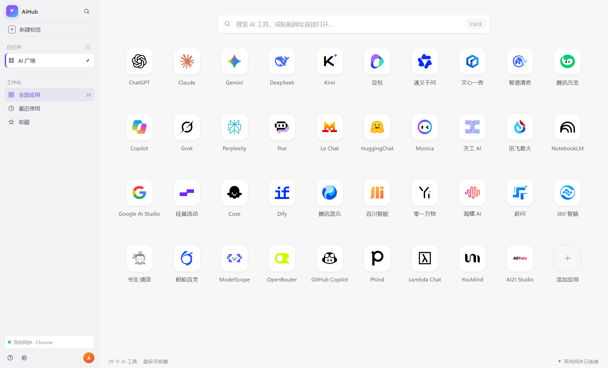

# AiHub

AI 聚合桌面工具：把常用的 AI 站点收进一个软件里直接使用，不必在浏览器标签间频繁切换。

- 内嵌浏览：一个窗口切换 ChatGPT、Claude、Gemini、DeepSeek、豆包、Kimi 等 39 个站点
- **应用管理**：AI 广场卡片悬停 `⋯` 或右键即可置顶/取消置顶、编辑名称/网址、删除；置顶显示金色描边，收藏与菜单都在卡片右侧
- **可编辑地址栏**：在站点内直接输入 URL 回车跳转；**顶部横向标签 + 左侧竖向标签**同时显示；左侧栏可折叠为 64px 图标栏（按钮或 Ctrl/Cmd+B），状态会记住
- **Cookie 双向同步**：浏览器里登录过的，AiHub 不用再登录；AiHub 里登录的，浏览器刷新后也登录
- **首次选择浏览器**：自动检测 Chrome / Edge / Brave / Vivaldi / Opera，选一个链接；没装浏览器也能用
- **原生窗口**：Windows 右上角系统按钮、macOS 左上角红黄绿，不做自绘标题栏
- 支持 Windows 10/11 与 macOS（Apple Silicon / Intel）
- 只同步登录凭证（Cookie + localStorage + sessionStorage），不导入插件、不改浏览器设置
- **全站凭证模式**：浏览器中所有站点的 Cookie、localStorage、sessionStorage 都会双向同步（包括登录态）；扩展会提示“读取所有网站数据”
- **扩展同步开关**：popup 顶部可暂停/恢复同步；暂停后不读 Cookie，也不发本地请求
- **Webview 兼容**：使用标准 Chrome UA，避免 DeepSeek 等站点误判“使用环境异常”
- **完整 Web 登录凭证**：同步 Cookie + localStorage + sessionStorage（所有站点）；DeepSeek 的 `userToken` 也在内
- 可打包为 Windows 安装包（NSIS）与 macOS DMG

## 当前进度（v0.1.1 / M2）

已可运行：

- Electron 原生窗口、AI 广场、39 站点、搜索、收藏/最近、顶部标签栏、左侧竖向标签、webview
- Chrome / Edge / Brave / Vivaldi / Opera 探测、Profile 选择
- **Bridge 扩展 + 本地服务 + 双向 Cookie 同步**（全量、增量、删除、冲突策略）
- **3 步初始化向导**：选择浏览器 → 安装 Bridge → 同步策略
- 设置抽屉：登录态状态、立即同步、更换/解除浏览器、冲突策略、账号域
- Windows 未签名 NSIS + 便携版已产出（安装包内含 Bridge 扩展）

Chrome 137+ 正式版已移除 `--load-extension`，扩展需要在 `chrome://extensions` 里用“加载已解压的扩展程序”一次性加载；向导第 2 步会给目录和入口。



## 开发与构建

```bash
npm install
npm run dev          # 开发模式
npm run sync:bridge  # 从 shared/domains 生成扩展 manifest
npm run build:win    # Windows NSIS + portable（未签名）
npm run build:mac    # 需要 macOS 环境
```

也可以双击根目录的 **`打包AiHub.bat`** 进行本地 Windows 打包；它会在结束时列出安装包。终端调用可加 `--no-pause`。

也可以直接双击根目录的 **`启动AiHub.bat`**：它会检查 npm / Electron 是否就绪，然后执行 `npm run dev`，并使用项目内的 `.electron-data` 作为开发数据目录。首次使用前仍需先执行一次 `npm install`。

## 发布

推送 `v*` tag 会自动触发 GitHub Actions，构建 Windows / macOS 并创建 GitHub Release：

```bash
git tag v0.1.1
git push origin v0.1.1
```

tag 必须与 `package.json` 的 `version` 一致。工作流见 `.github/workflows/release.yml`，Release 会附带安装包、便携版、DMG/ZIP。

如果 `npm install` 后 Electron 没下载完整（国内网络）：

```powershell
$env:ELECTRON_MIRROR='https://npmmirror.com/mirrors/electron/'
node node_modules/electron/install.js
```

Windows 安装包输出在 `release/`。项目路径含中文时，`npm run build:win` 会自动把构建输出切到 ASCII 临时目录，避免 NSIS 两段式构建失败。

> 注意：NSIS 安装器**从含中文的路径直接启动**时会报 “Error writing temporary file”。默认产物只写入项目 `release/`；如确实需要额外的纯英文发布目录，请显式设置 `AIHUB_PUBLISH_DIR`，或手动把安装包复制到纯英文路径。

## 免费签名 / 首次运行提示

v1 不购买证书：

- Windows 未签名：SmartScreen「更多信息 → 仍要运行」
- macOS ad-hoc 签名、未公证：系统设置 → 隐私与安全性 → 仍要打开
- 开源后可申请 SignPath Foundation / Certum OSS 免费签名；Apple 公证需要 Apple Developer Program（$99/年）

完整说明见 [分发与签名](docs/分发与签名.md)。

## 浏览器支持

Chrome / Edge / Brave / Vivaldi / Opera 完整支持；QQ / 360 / 搜狗 / Arc / Yandex 走手动路径 + 兼容性检测；Firefox 计划 v1.1；Safari 需要独立 Safari Web Extension，计划 v2。

## 文档

- [技术方案](docs/技术方案.md)
- [分发与签名（免费方案）](docs/分发与签名.md)
- [实际运行截图](docs/screenshots/home.png)
- [新图标效果图](docs/screenshots/icon-preview.png)
- [桌面 / 任务栏效果](docs/screenshots/icon-desktop.png)
- [初始化第 1 步](docs/screenshots/onboarding.png)
- [初始化第 2 步](docs/screenshots/onboarding-step2.png)
- [初始化第 3 步](docs/screenshots/onboarding-step3.png)
