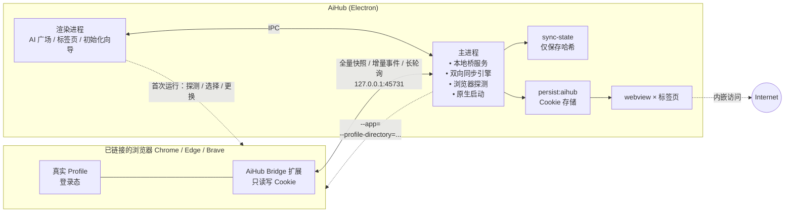
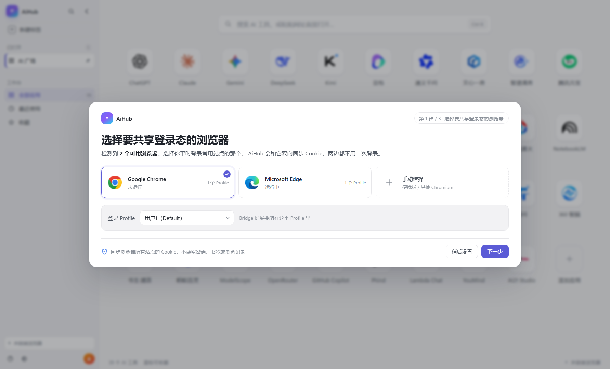
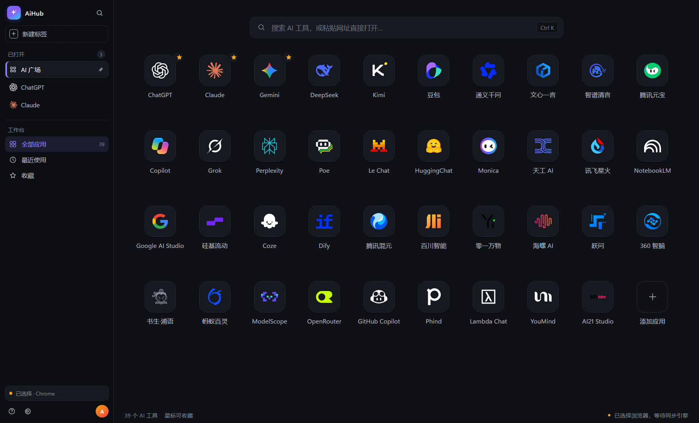
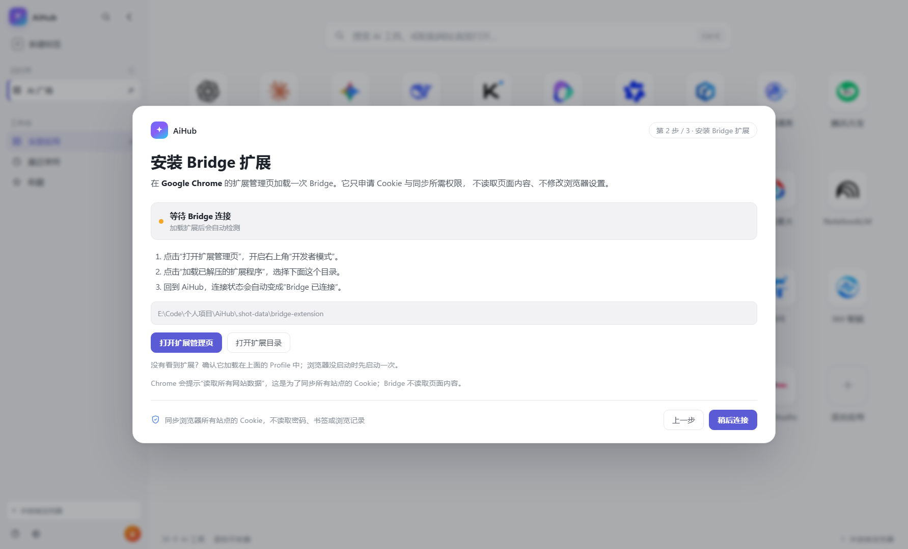
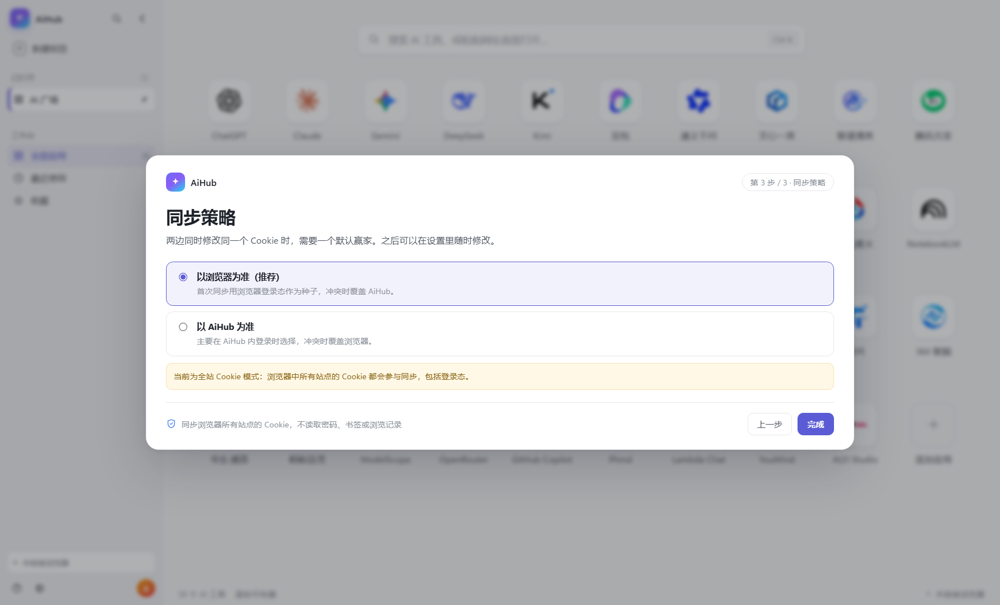

# AiHub 技术方案（v1.0）

> 版本：0.3 · 日期：2026-10-23 · 目标平台：Windows 10/11 x64 · macOS（Apple Silicon / Intel）
> 范围：**只做 Cookie 双向同步**，不做插件/扩展管理
> 技术栈：Electron 45 + React 19 + TypeScript + electron-vite + electron-builder

---

## 0. 结论先行

AiHub v1 只解决一件事：**让 AiHub 内嵌浏览器和用户已有的 Chrome / Edge 共享同一份登录态，并且双向同步**——浏览器登录过的，AiHub 不用再登录；在 AiHub 里登录的，浏览器刷新后也不用再登录。

实现上采用 **「一个外壳 + 一条双向同步链路 + 选择与兜底」**：

1. **内嵌通道（主界面）**：Electron `<webview>` 承载 AI 站点，AI 广场选应用、左侧竖向标签切换，共用一个持久化会话 `persist:aihub`。
2. **同步通道（核心）**：随包附带 **AiHub Bridge** 浏览器扩展，只读写 Cookie；通过 `127.0.0.1` 本地服务与 AiHub 双向同步。扩展是唯一能在浏览器运行时读写 Cookie 的可靠通道（原因见 §3）。
3. **初始化选择**：首次启动自动检测 Chrome / Edge / Brave 等 Chromium 浏览器与 Profile，让用户**选择一个要链接的浏览器**；没装浏览器就跳过，AiHub 独立使用，之后可随时在设置里更换。
4. **兜底**：Google 系登录被内嵌拦截时，用本机真实浏览器 `--app` 打开；没有浏览器时，直接在 AiHub 内登录。

三个绕不开的限制（本机实测，见 §3）：

- Electron 与系统 Chrome/Edge 是两套 profile，不能直接挂载。
- 浏览器运行时 Cookies 文件被独占锁定，且新版 Cookie 是 v20 应用绑定加密，**离线直读不可行**。
- 要"双向、实时"，就必须有一个跑在浏览器里的扩展作为读写代理；没有扩展时只能做到"AiHub 内单独登录"。

因此：**内嵌负责体验，Bridge 负责双向登录态，原生窗口负责 Google 登录兜底；浏览器可选、可换、可没有。**

---

## 1. 产品目标与边界

### 1.1 目标

| 编号 | 目标 | v1 验收方式 |
|---|---|---|
| G1 | 一个窗口内切换常用 AI 站点，不来回切浏览器标签 | AI 广场 39 个预置站点 + 左侧竖向标签，点击即用，切换不丢会话 |
| G2 | 可打包成 Windows / macOS 安装包 | Windows NSIS + 便携版；macOS DMG + zip（x64 / arm64） |
| G3 | **Cookie 双向同步**，消除二次登录 | 浏览器登录 → AiHub 已登录；AiHub 登录 → 浏览器刷新后已登录；登出也同步 |
| G4 | 首次运行选择要链接的浏览器 | 自动检测 Chrome/Edge/Brave + Profile；无浏览器可跳过；设置里可更换 |
| G5 | 登录态可持久化 | 重启应用后仍保持登录 |
| G6 | 无浏览器也能用 | 未检测到浏览器时走 AiHub 内登录，不阻塞主流程 |
| G7 | 原生兜底 | 一键用已链接浏览器真实 profile 打开当前站点 |

### 1.2 非目标（v1 不做）

- **不做插件/扩展管理**：不扫描、不导入、不加载浏览器扩展；Bridge 扩展只用于 Cookie 同步。
- 不做完整浏览器（书签、下载管理、扩展商店）；只保留**当前标签的可编辑地址栏**用于直接跳转。
- 不做账号密码托管、不做 Chrome 密码库读取。
- 不做 Chrome Web Store / Edge Add-ons 自动安装（Bridge 仍需一次性手动加载）。
- 不做 Firefox / Safari 同步（扩展 API 不同，v1 不支持）。
- 不做云同步、不做多人协作。
- 不做原生窗口的 Win32 嵌入（v1.1 实验项，见 §17）。

---

## 2. 用户故事

1. 第一次打开 AiHub，看到 AI 广场；同时弹出初始化向导："检测到 Chrome 156 / Edge 155，选择要共享登录态的浏览器"。
2. 用户选 Chrome → 按引导加载 Bridge 扩展 → 自动全量同步，AiHub 内的 ChatGPT / Claude / Gemini 直接是登录态，**不需要二次登录**。
3. 用户的电脑只有 Edge → 向导推荐 Edge，流程相同；只有 Firefox → 提示暂不支持，可跳过，在 AiHub 内登录。
4. 用户在 AiHub 里登录了 Claude → 回到 Chrome 刷新 Claude，发现也登录了（**反向同步**）。
5. 用户在 Chrome 里退出 ChatGPT → AiHub 收到删除事件，刷新后同步退出。
6. 用户点 Gemini 的 Google 登录被拦 → 顶部提示"用已链接浏览器打开" → 原生窗口完成登录 → 回到 AiHub 自动同步。
7. 用户换了电脑或换了浏览器 → 设置 →「登录态共享」→ 更换链接浏览器，重新合并，不用重新装 AiHub。
8. 用户把安装包发给同事，同事装完即可用，不需要配置 Node 或浏览器；没有浏览器也能先用。
9. Mac 用户：窗口按钮就是系统左上角的红黄绿，不做任何自绘；Chrome / Edge / Brave 的链接流程与 Windows 一致。Safari 暂不支持同步，可先用 Chromium 浏览器登录。

---

## 3. 关键技术约束（本机实测）

### 3.1 实测环境

| 项 | 值 |
|---|---|
| Chrome | 156.0.8078.48（`C:\Program Files\Google\Chrome\Application\chrome.exe`） |
| Edge | 155.0.4283.62（`C:\Program Files (x86)\Microsoft\Edge\Application\msedge.exe`） |
| Electron | 45.0.0（当前 latest） |
| 构建 | electron-vite 6.0.0 / Vite 8.3.5 / React 19.3.1 / electron-builder 26.15.3 |
| 包管理 | npm 11.12.1 + npmmirror registry |

> 上述为 Windows 本机实测。macOS 路径、DMG 打包与红黄绿行为需要在 macOS 或 CI 上验证，不能只靠 Windows 推断。

### 3.2 约束一：两套 Chromium，profile 不通用

Electron 的 `session` 与系统 Chrome 的 `User Data` 目录结构、版本、加密密钥均独立。
把 Electron 指向 Chrome 的 `--user-data-dir` 属于未支持行为，可能损坏用户数据，**明确不做**。

> 影响：内嵌页面必须自己维护一份会话（`persist:aihub`），"共享"只能通过数据导入/同步实现。

### 3.3 约束二：浏览器运行时 Cookies 文件被独占

本机实测（Chrome 正在运行）：

```text
Copy-Item "...\User Data\Default\Network\Cookies" → WinError 32（另一个程序正在使用此文件）
SQLite 以 mode=ro 打开 → unable to open database file
```

结论：**不能在 Chrome/Edge 运行时直接读 Cookies 数据库**。
退出浏览器后复制只能做一次性导入，无法满足"双向、实时"，而且会打断用户正在进行的浏览。

### 3.4 约束三：v20 App-Bound Encryption

本机 `Local State` 同时存在：

- `os_crypt.encrypted_key`（DPAPI，老版 v10 用）
- `os_crypt.app_bound_encrypted_key`（`APPB` 前缀，Chrome 127+ 的 v20 用）

v20 Cookie 的解密密钥由 Chrome 的 elevation service 校验调用方身份，**普通进程拿不到**。
纯 DPAPI 解密只能处理历史 v10 Cookie，覆盖不了现在的登录态。

> 影响：纯 DPAPI 解密覆盖不了现在的登录态，离线导入也不可靠；实时双向只能由浏览器内的扩展代理读写。

### 3.5 约束四：Google 拒绝内嵌登录

Google OAuth 对 embedded webview / 非标准 UA 会返回 "disallowed_useragent"。
Gemini、Google 账号登录在 Electron 里成功率不稳定。

> 影响：必须提供"原生浏览器窗口"逃生舱，并在 UI 上给出明确引导，而不是让用户卡在登录页。

### 3.6 约束五：双向同步必须有浏览器内代理

浏览器 Cookie 只能由浏览器进程（或扩展 API）安全读写。外部进程即使拿到文件，也无法可靠解密 v20，更无法把 AiHub 里的新登录态写回浏览器。

> 影响：**没有 Bridge 扩展，就没有双向同步**。此时只能退化为"AiHub 内单独登录"，不能假装能共享。

### 3.7 推论

| 需求 | 能直接做到吗 | 采用手段 |
|---|---|---|
| 浏览器运行时读取 Cookie | 否（文件锁） | Bridge 扩展 |
| 解密 / 写入 v20 Cookie | 否（ABE） | Bridge 扩展 |
| **双向实时同步** | 否（无浏览器内代理） | **Bridge 扩展** |
| 没有浏览器时使用 | 是 | 跳过同步，AiHub 内登录 |
| Google 登录兜底 | 是 | 原生 `--app` 窗口 |
| 一个窗口内切换 | 是 | `<webview>` |

---

## 4. 方案选型

### 4.1 外壳技术

| 方案 | 多站点内嵌 | 实时双向 Cookie | 结论 |
|---|---|---|---|
| **Electron** | 成熟（webview / WebContentsView） | 需 Bridge 扩展 | **采用** |
| Tauri v2 + WebView2 | 多 WebView 仍偏实验 | 同样需 Bridge 扩展 | 不采用 |
| CEF | 成熟 | 需 Bridge 扩展 | 不采用 |
| 纯套壳（只开浏览器窗口） | 否 | 原生共享 | 仅作兜底通道 |

### 4.2 Cookie 共享手段

| 方案 | 浏览器运行时可用 | 覆盖 v20 | 双向 | 定位 |
|---|---|---|---|---|
| 直接复制 Cookies DB | 否（独占锁） | 否 | 否 | 不可行 |
| DPAPI 纯解密 | 否 | 否 | 否 | 仅历史 v10 |
| 退出浏览器 + 复制 / CDP | 否（需退出） | 部分（待 POC） | 否 | v1 不做，投入产出低 |
| **Bridge 扩展 + 本地服务** | **是** | **是** | **是** | **主方案** |
| 原生 `--app` 窗口 | 是 | 是 | 否（独立窗口） | 登录兜底 |

### 4.3 内嵌实现：`<webview>` vs `WebContentsView`

| 维度 | `<webview>` | `WebContentsView` |
|---|---|---|
| 与 React 布局 | DOM 元素，直接参与布局 | 原生视图，需主进程算 bounds |
| 弹层/设置抽屉 | 天然覆盖 | 原生视图盖在 DOM 之上，必须临时隐藏 |
| 多实例管理 | 简单 | 需自己维护 view 栈 |
| 官方态度 | 不推荐但长期支持 | 推荐 |
| 结论 | **v1 采用** | v1.1 评估迁移 |

采用 `<webview>` 的关键补偿措施：主进程用 `will-attach-webview` 强制关闭 Node、固定 partition、移除 preload（见 §8.1）。

---

## 5. 总体架构



各通道的职责：

| 通道 | 触发 | 数据来源 | 用户体验 | 失败降级 |
|---|---|---|---|---|
| 内嵌 | 日常使用 | `persist:aihub` | 一个窗口切换 | 提示用原生窗口 |
| **双向同步** | 链接浏览器后持续 | 扩展 Cookie API | 两边都不重复登录 | 浏览器未连接时先排队，用原生窗口登录 |
| 原生 | Google 登录 / 强校验站点 | 真实浏览器 profile | 独立应用窗口 | 无（最终兜底） |
| 无浏览器 | 未安装 Chromium | `persist:aihub` | 与普通应用一致 | 跳过同步，AiHub 内登录 |

UI 外壳（左侧竖向标签栏 + AI 广场网格）只负责导航，实际页面内容都在 webview 中；标签页与 webview 的生命周期由渲染进程的 `useTabs` 统一管理（见 §11）。

---

## 6. Cookie 双向同步详细设计

### 6.1 目标与原则

| 原则 | 说明 |
|---|---|
| 双向 | 浏览器 → AiHub，AiHub → 浏览器；新增、修改、删除都同步 |
| 免二次登录 | 任意一边登录，另一边刷新后即为登录态 |
| 实时 | 两边都打开时 1–3 秒内同步；断线后靠全量对账恢复 |
| 可恢复 | 扩展/AiHub 重启后做全量三方合并，不丢登录态 |
| 全站模式 | 同步浏览器中所有站点的 Cookie（用户明确要求；会包含银行等敏感登录态，需自担风险） |
| 可解释 | 冲突有明确策略与提示，不静默覆盖 |
| 可没有 | 未安装浏览器时跳过同步，AiHub 内登录即可 |

v1 **只链接一个浏览器 + 一个 Profile**（用户可在设置里更换）。多浏览器并行同步放到 v1.1。

### 6.2 链接模型

首次启动由向导探测并让用户选择（详见 §7），结果存入配置：

```jsonc
"sync": {
  "enabled": true,
  "browser": {
    "id": "chrome",
    "label": "Google Chrome",
    "exe": "C:\\Program Files\\Google\\Chrome\\Application\\chrome.exe",
    "userDataDir": "C:\\Users\\<user>\\AppData\\Local\\Google\\Chrome\\User Data",
    "profileDir": "Default",
    "profileName": "用户 1"
  },
  "conflict": "browser"
}
```

- `browser` 用于原生窗口打开、状态展示和“更换浏览器”。
- 扩展实际连接的是**安装扩展的那个 Profile**；向导会明确提示“请在你选择的 Profile 中加载 Bridge”。
- 更换浏览器：先暂停同步 → 解除旧链接 → 新浏览器做一次全量三方合并 → 继续双向。旧浏览器里已写入的 Cookie 不回收。
- 链接的浏览器被卸载/路径失效：状态变 `browser-missing`，暂停同步并提示重选；不删除 AiHub 现有 Cookie。
- 未链接/已跳过：`enabled=false`，AiHub 完全可用，只是不同步。

### 6.3 Bridge 扩展（只做 Cookie）

| 组件 | 位置 | 职责 |
|---|---|---|
| MV3 扩展 | `resources/browser-bridge/`（随安装包分发） | 读取/写入 Cookie、监听变化、长轮询接收 AiHub 下发的操作 |
| 本地服务 | `src/main/bridge/server.ts` | 校验来源、全量合并、增量队列、长轮询 |
| 同步引擎 | `src/main/bridge/sync-engine.ts` | 三方合并、回声抑制、冲突策略 |
| 状态文件 | `%APPDATA%/AiHub/sync-state.json` | 只存哈希与时间，不存 Cookie 值 |
| 站点存储 | `%APPDATA%/AiHub/site-storage.json` | 按 origin 保存 localStorage / sessionStorage；含登录 token，仅本机 |

扩展清单（关键字段）：

```json
{
  "manifest_version": 3,
  "name": "AiHub Bridge",
  "description": "同步浏览器所有站点的 Cookie 到 AiHub，不修改页面。",
  "version": "0.1.0",
  "key": "<固定扩展 ID 用的公钥>",
  "permissions": ["cookies", "alarms", "storage"],
  "host_permissions": ["<all_urls>"],
  "background": { "service_worker": "background.js" },
  "action": { "default_popup": "popup.html" }
}
```

- **不申请** `tabs`、`webRequest`、`scripting`，不注入页面、不改浏览器 UI；但 `<all_urls>` 会让 Chrome 提示“读取所有网站数据”。
- `key` 固定扩展 ID，服务端据此做 Origin 白名单；Chrome / Edge / Brave 通用。
- `host_permissions` 固定为 `<all_urls>`，由 `scripts/sync-bridge-domains.mjs` 生成；不再维护域名白名单。

扩展后台逻辑：

| 事件 | 行为 |
|---|---|
| `onInstalled` / `onStartup` | 探测本地服务 → 全量同步 |
| `chrome.cookies.onChanged` | 1s 防抖，批量 POST 增量（set/remove） |
| 长轮询循环 | `GET /v1/events` 挂起 25s，收到操作后 `chrome.cookies.set/remove`，立即再轮询 |
| `chrome.alarms` 每 1 分钟 | 看门狗：轮询停了就重启；超过 3 分钟没同步则触发全量 |
| popup | 连接状态、上次同步、立即同步、冲突计数 |

> MV3 的 service worker 会被浏览器挂起；用“挂起 25s 的 fetch + 每分钟 alarm 唤醒”维持可用性，不用 WebSocket，少一个依赖、也少一类断线问题。

安装方式仍是**一次性手动加载**（Chrome/Edge 不允许程序静默安装）：

1. AiHub 把随包扩展复制到用户目录（`%APPDATA%/AiHub/bridge-extension`，纯 ASCII，避免中文安装路径导致 Chrome 加载失败），向导展示这个目录。
2. 打开 `chrome://extensions`（Edge 为 `edge://extensions`）→ 开发者模式 → 加载已解压的扩展程序。
3. 扩展 popup 显示“已连接”；AiHub 向导自动检测并进入下一步。
4. popup 顶部有“启用同步”开关：关闭后扩展停止全量、长轮询和所有本地请求，不再读取/写入 Cookie；状态存入 `chrome.storage.local`，service worker 重启后仍保持。重新开启时做一次全量三方对账。

### 6.4 双向同步协议

#### 6.4.1 标识与哈希

```text
key       = domain + "|" + path + "|" + name
canonical = JSON { value, secure, httpOnly, sameSite, hostOnly, session }
hash      = SHA-256(canonical)
```

- 忽略 `storeId`：浏览器 Profile 与 AiHub 会话的 store 不同，不应作为身份。
- 哈希**不包含过期时间**：Chromium 会把 Cookie 寿命截断到约 400 天，比较原始 expiry 会让两边永远"不同"。
- 哈希包含安全属性与 `session` 标志；值、Secure、HttpOnly、SameSite、hostOnly 变化都会同步。
- `sync-state.json` 只保存 `key → { hash, updatedAt, source }`，不保存值。

#### 6.4.2 全量合并（三方）

扩展在连接/重连/手动同步时提交该域集合的全量快照；主进程用 `B`（浏览器）、`A`（AiHub）、`S`（上次同步哈希）做三方合并：

| B | A | S | 判定 | 动作 |
|---|---|---|---|---|
| 有 | 有 | 有 | `B == A` | 无变化，更新 S |
| 有 | 有 | 有 | `A == S`，`B != S` | 浏览器改了 | 写入 AiHub，S=B |
| 有 | 有 | 有 | `B == S`，`A != S` | AiHub 改了 | 下发浏览器，S=A |
| 有 | 有 | 有 | 两边都改且不同 | **冲突** | 按策略（默认浏览器） |
| 有 | 无 | 无 | 浏览器新增 | 写入 AiHub |
| 有 | 无 | 有 | `B == S` | AiHub 删除 | 浏览器删除 |
| 有 | 无 | 有 | `B != S` | 删除 vs 浏览器改 | 冲突 |
| 无 | 有 | 无 | AiHub 新增 | 下发浏览器 |
| 无 | 有 | 有 | `A == S` | 浏览器删除 | 删除 AiHub |
| 无 | 有 | 有 | `A != S` | 删除 vs AiHub 改 | 冲突 |
| 无 | 无 | 有 | 两边都删 | 清理 S |

- 全量合并的输出是 `applyToBrowser` 操作列表 + `appliedToApp` 数量 + `conflicts` 数量。
- 扩展应用后回传 `ack`，主进程更新 S；失败项计数并保留，下次重试。
- `S` 以**写入后实际归一化的 Cookie** 为准（ack 回传 hash），避免 Chromium 字段归一化导致假冲突。
- **首次链接**时 AiHub 通常为空，浏览器直接作为种子；若 AiHub 已有 Cookie，则走完整三方合并。

#### 6.4.3 增量同步

| 来源 | 事件 | 处理 |
|---|---|---|
| 浏览器 | `cookies.onChanged` 新增/修改/删除 | 1s 防抖合批 → `POST /v1/events` → 写 AiHub |
| AiHub | `session.cookies.onChanged` 新增/修改/删除 | 过滤域 → 300ms 防抖 → 入队（seq++） |
| 扩展 | 长轮询拿到 AiHub 操作 | `chrome.cookies.set/remove` → 回 `ack` |

- AiHub 侧事件队列在内存中，上限 1000 条；溢出时丢弃队列并置 `needsFullSync`，下一次轮询返回 `reset`，扩展立刻做全量。
- 不把待发 Cookie 值落盘：断线期间的变化靠重连后的全量合并恢复，避免敏感值多一份副本。

#### 6.4.4 长轮询协议

```http
GET /v1/events?since=42&session=<appSessionId>
Origin: chrome-extension://<fixed-id>   # Chrome SW 实测可能不发送
X-AiHub-Bridge: 1
```

- 无事件时挂起 25s 后返回空；有事件立即返回，扩展马上再发起下一次。
- `session` 与当前主进程不一致（AiHub 重启）→ 返回 `{ reset: true }`，扩展触发全量。
- `since` 太旧/队列已重置 → `{ reset: true }`。
- 扩展通常只保持一个长轮询；服务端支持多个等待者并广播，不做 409 限制。
- 扩展应用事件后调用 `POST /v1/ack-events`，AiHub 才推进 `S`；失败的条目留给下一次全量重试。
- `/v1/health` **只用于首次连接/重连时探测端口**，稳定期不轮询；优先尝试上次成功端口，失败后退避 5s → 10s → … → 60s，且不会每 2.5s 扫全部端口。
- 未链接浏览器时 `/v1/sync` 返回 409，但 `/v1/events` 仍可长轮询；扩展不会反复请求 health，链接后由 `syncNow` 唤醒。

```jsonc
// 返回
{
  "session": "3f2c...",
  "cursor": 43,
  "reset": false,
  "events": [
    { "seq": 43, "op": "set", "cookie": { /* BridgeCookie */ } },
    { "seq": 44, "op": "remove", "key": "chatgpt.com|/|token" }
  ]
}
```

#### 6.4.5 回声抑制

- 写入方在下发/应用前，把 `hash` 放入 `suppress`（TTL 3s）。
- 对端 `onChanged` 回来时，若 `hash` 命中且未过期，丢弃。
- 全量合并不产生增量事件；合并完成后直接更新 S，避免二次回环。
- 代价：同一 Cookie 在 3s 内被真实改回同一值会被忽略，概率极低，可接受。

#### 6.4.6 冲突策略

| 策略 | 行为 | 适用 |
|---|---|---|
| **browser（默认）** | 冲突时以浏览器为准，覆盖 AiHub | 首次链接、以浏览器为主力 |
| app | 冲突时以 AiHub 为准，覆盖浏览器 | 主要在 AiHub 内登录 |

- 冲突不阻塞同步，按策略处理后在底部提示“2 个登录态冲突，已按浏览器优先处理”。
- **重要风险**：Google/Microsoft 账号 Cookie 也在同步范围内。若 AiHub 里登录了另一个 Google 账号，反向同步会把浏览器的 Google 登录态覆盖成该账号。首次向导会提示“建议两边使用同一账号”；高级设置可排除账号域（见 §6.5）。
- v1 不做逐条冲突选择 UI。

#### 6.4.7 删除与过期

- 显式删除（用户在任一边退出登录）按增量同步；对端执行删除。
- `expired` / 过期清理视为删除，但只对同步域生效。
- 全量合并中“一边缺失”按 §6.4.2 判断是删除还是新增，不能一概删除。

#### 6.4.8 生效时机（必须说明）

写入 Cookie **不会**让已经打开的页面立刻变成登录态：

- 浏览器 → AiHub：已打开的对应标签页需要刷新；AiHub 弹 Toast「登录态已更新」+「刷新」按钮，不自动刷新，避免丢掉输入框里的内容。
- AiHub → 浏览器：已打开的浏览器标签页需要刷新；扩展 popup 提示「已同步，刷新页面生效」。v1 不申请 `tabs` 权限，不自动刷新。
- 首次同步发生在打开站点之前，通常无感。

#### 6.4.9 断线与恢复

```text
浏览器关闭 / 扩展未连接
  → AiHub 内变化只入内存队列（不落盘）
  → 浏览器下次启动，扩展连接 → 全量三方合并 → 补发
AiHub 关闭
  → 浏览器内变化留在浏览器
  → AiHub 下次启动 → 全量三方合并 → 拉回
两边都关闭且都改过
  → 全量合并 → 冲突按策略处理
```

### 6.5 同步范围

- 同步浏览器中**所有站点**的 Cookie（包括 AI、小红书、银行等）；不做域名过滤。
- `partitionKey`（CHIPS）Cookie 暂时跳过。
- 无痕窗口默认不启用扩展，不同步（预期行为）。
- 全站模式意味着浏览器里的敏感登录态也会进入 AiHub 的 `persist:aihub` 分区，请只在个人设备使用。
- **Web 登录凭证**：除 Cookie 外，扩展 content script 在 `<all_urls>` 读取 `localStorage` / `sessionStorage`，按 origin 同步到 `site-storage.json`；webview 在 `dom-ready` 注入并 reload 一次。DeepSeek 的 `userToken`、其他站点的 token 都在此范围内。
- 当前**不同步 IndexedDB、Cache Storage、Service Worker 缓存**：这些结构带 schema/索引，粗暴复制可能破坏站点数据；需要时再按站点做受控适配。
- `site-storage.json` 会保存 token / 用户信息等敏感数据，和 Cookie 一样只留在本机，不上传云端。

### 6.6 Cookie 映射规则

浏览器 → AiHub：

```ts
await ses.cookies.set({
  url: cookieUrl(c),
  name: c.name,
  value: c.value,
  ...(c.hostOnly ? {} : { domain: c.domain }),
  path: c.path,
  secure: c.secure,
  httpOnly: c.httpOnly,
  sameSite: c.sameSite,
  expirationDate: c.session ? undefined : c.expirationDate,
});
```

AiHub → 浏览器（扩展内）：

```ts
await chrome.cookies.set({
  url: cookieUrl(c),
  name: c.name,
  value: c.value,
  ...(c.hostOnly ? {} : { domain: c.domain }),
  path: c.path,
  secure: c.secure,
  httpOnly: c.httpOnly,
  sameSite: c.sameSite,
  expirationDate: c.session ? undefined : c.expirationDate,
  storeId,                       // 浏览器默认（非无痕）store
});
```

特殊场景：

| 场景 | 处理 |
|---|---|
| `__Host-` 前缀 | 必须 `secure + path=/ + 无 domain`；否则跳过并计数 |
| `__Secure-` 前缀 | 必须 secure |
| SameSite=None | 必须 secure，否则跳过 |
| 已过期 | 跳过，不写入 |
| 分区 Cookie（CHIPS） | v1 跳过并在结果中提示；v1.1 评估 `partitionKey` |
| 域名非法 / IP 站点 | 跳过并记录错误码，不阻断整批 |
| `storeId` | 浏览器 → AiHub 忽略；AiHub → 浏览器用默认 store |
| 大小写/前导点 | 按 Chrome 返回值原样保留，不自行规范化 |

### 6.7 本地服务安全

Cookie 是敏感数据，且现在需要**下发**给扩展，安全要求比单向更高：

1. 只绑定 `127.0.0.1`，不监听 `0.0.0.0`。
2. 校验 `Host` 必须是 `127.0.0.1:<port>`，防 DNS rebinding。
3. **Origin 规则**：如果带 `Origin`，必须是 `chrome-extension://<固定 ID>`；网页来源一律 403。Chrome 扩展 service worker 请求本地服务时实测**不带 Origin**，因此允许“无 Origin + 桥接头”的请求；网页无法在缺少 Origin 的情况下带自定义头跨域请求。
4. 强制 `X-AiHub-Bridge: 1`；网页跨域必须走 preflight，preflight 带 Origin，会被拒绝。
5. 只有 `/v1/events` / `/v1/sync` 在双向同步中携带 Cookie，且只返回给固定扩展 ID 建立的本地会话；不提供按域名查询 Cookie 的通用接口。
6. 限制 body ≤ 16MB、全量 ≤ 5000 条 Cookie、事件 ≤ 500 条/批；长轮询单连接。
7. 日志只记数量、域名、错误码，绝不打印 Cookie 值（开发调试日志也不打印值）。
8. `sync-state.json` 只存哈希；临时数据不落盘。
9. 扩展 ID 通过 manifest `key` 固定，实测 Chrome 加载后的 ID 与 `BRIDGE_EXTENSION_ID` 一致（本地恶意进程不在威胁模型内；它本来就能读浏览器数据）。

### 6.8 原生浏览器窗口（登录兜底）

```ts
const args = family === 'firefox'
  ? ['-profile', profile.path, '-new-window', url]
  : [`--profile-directory=${profile.dir}`, `--app=${url}`];

spawn(browser.exe, args, { detached: true, stdio: 'ignore' }).unref();
```

- Windows 与 macOS 都用同一个可执行文件路径（macOS 是 `.app/Contents/MacOS/...`），参数一致；浏览器已在运行时新进程会把参数转交给现有实例。
- Chromium 系支持 `--app`，打开无地址栏窗口；Firefox 没有 app 模式，用普通新窗口。
- Google 系登录被内嵌拦截时，用这个窗口完成登录；登录产生的 Cookie 会通过 Bridge 反向同步回 AiHub。
- 没有链接浏览器时隐藏该入口，或退回 `shell.openExternal(url)`。

### 6.9 降级链

```text
已链接浏览器？
  ├─ 否 → 仅 AiHub 内登录（无同步，不报错）
  └─ 是 → Bridge 扩展已连接？
            ├─ 是 → 双向实时同步
            └─ 否 → AiHub 内可正常用；变化先排队
                      └─ 需要 Google 登录 → 用原生窗口打开
```

状态展示：

| 状态 | 文案 | 颜色 |
|---|---|---|
| `connected` | 双向同步 · Chrome | 绿 |
| `waiting` | 等待浏览器启动 / 安装 Bridge | 黄 |
| `browser-missing` | 未找到 Chrome，请重新选择 | 红 |
| `disabled` | 未链接浏览器 | 灰 |

---

## 7. 浏览器探测与初始化

这一节解决“软件怎么知道该连哪个浏览器、没有浏览器怎么办”。

### 7.1 支持范围

按"扩展模型"分三类，不是按浏览器品牌硬编码：

| 浏览器 | 内核 | v1 | 说明 |
|---|---|---|---|
| Google Chrome | Chromium | ✅ 完整 | Windows / macOS |
| Microsoft Edge | Chromium | ✅ 完整 | Windows / macOS |
| Brave | Chromium | ✅ 完整 | Windows / macOS |
| Vivaldi | Chromium | ✅ 完整 | Windows / macOS |
| Opera | Chromium | ✅ 完整 | Windows / macOS |
| Arc | Chromium | ⚠️ 手动 | 扩展加载方式特殊，需实测 |
| Yandex | Chromium | ⚠️ 手动 | 路径手动指定 |
| QQ 浏览器 | Chromium | ⚠️ 需实测 | 国内版本差异大；必须确认 Chromium ≥ 110 / 支持 MV3 |
| 360 安全/极速浏览器 | Chromium | ⚠️ 需实测 | 同上 |
| 搜狗浏览器 | Chromium | ⚠️ 需实测 | 同上 |
| Firefox | Gecko | 🔜 v1.1 | 需要单独的 Firefox 扩展包，同步引擎复用 |
| Waterfox / LibreWolf / Floorp | Gecko | 🔜 v1.1 | 跟随 Firefox 适配 |
| Safari / Safari Technology Preview | WebKit | ⏳ v2 | 不能加载 Chrome 扩展；需要 Xcode 工程 + Apple 开发者签名/公证 |
| IE / 旧 Edge / DuckDuckGo | — | ❌ | 无扩展模型或已停止支持 |

三类实现方式：

1. **Chromium 通用（一个 Bridge 包）**：Chrome、Edge、Brave、Vivaldi、Opera、Arc、Yandex、QQ、360、搜狗。扩展 API 相同，差异只在安装路径、User Data 路径、进程名和原生启动参数。QQ / 360 / 搜狗是否支持 MV3 需要按版本实测。
2. **Firefox 系（第二个扩展包）**：Firefox、Waterfox、LibreWolf、Floorp。需要改 manifest（`browser_specific_settings.gecko.id`、`background.scripts`）和少量 API 适配（`browser.*` Promise 风格），同步引擎和本地服务完全复用。
3. **Safari（独立工程）**：Safari 不加载 Chrome 扩展，必须用 Xcode 做 Safari Web Extension，放进一个 Mac 容器 App，签名并公证；还要 Apple Developer 账号。它不是"换个路径"就能支持的，工作量与 Chromium 组不在一个量级。

> 关键点：**没装浏览器不是错误**。没有 Chromium 浏览器时，AiHub 仍然可以正常使用，只是不启用同步。

### 7.2 探测逻辑

**Windows**：

1. 注册表 `HKCU\Software\Microsoft\Windows\CurrentVersion\App Paths\<exe>`，再查 `HKLM`。
2. 常见安装路径：
   - `%ProgramFiles%\Google\Chrome\Application\chrome.exe`
   - `%ProgramFiles(x86)%\Google\Chrome\Application\chrome.exe`
   - `%LOCALAPPDATA%\Google\Chrome\Application\chrome.exe`
   - `%ProgramFiles(x86)%\Microsoft\Edge\Application\msedge.exe`
   - `%ProgramFiles%\Microsoft\Edge\Application\msedge.exe`
   - `%ProgramFiles%\BraveSoftware\Brave-Browser\Application\brave.exe`
   - `%LOCALAPPDATA%\Vivaldi\Application\vivaldi.exe`
   - `%LOCALAPPDATA%\Programs\Opera\opera.exe`
   - QQ / 360 / 搜狗：手动选择 exe（安装目录随版本变化）

**macOS**：

- `/Applications/Google Chrome.app/Contents/MacOS/Google Chrome`
- `/Applications/Microsoft Edge.app/Contents/MacOS/Microsoft Edge`
- `/Applications/Brave Browser.app/Contents/MacOS/Brave Browser`
- `/Applications/Vivaldi.app/Contents/MacOS/Vivaldi`
- `/Applications/Opera.app/Contents/MacOS/Opera`
- `~/Applications/...` 同样检查
- 手动选择时允许选 `.app`，解析 `Contents/MacOS/*`

**User Data 目录**：

| 浏览器 | Windows | macOS |
|---|---|---|
| Chrome | `%LOCALAPPDATA%\Google\Chrome\User Data` | `~/Library/Application Support/Google/Chrome` |
| Edge | `%LOCALAPPDATA%\Microsoft\Edge\User Data` | `~/Library/Application Support/Microsoft Edge` |
| Brave | `%LOCALAPPDATA%\BraveSoftware\Brave-Browser\User Data` | `~/Library/Application Support/BraveSoftware/Brave-Browser` |
| Vivaldi | `%LOCALAPPDATA%\Vivaldi\User Data` | `~/Library/Application Support/Vivaldi` |
| Opera | `%APPDATA%\Opera Software\Opera Stable` | `~/Library/Application Support/com.operasoftware.Opera` |
| QQ / 360 / 搜狗 | 手动指定 | 手动指定 |

拿到 exe 后：

- 推导 User Data 目录；读 `<User Data>/Local State` 的 `profile.info_cache`，得到 Profile 目录名、显示名、`last_used`。
- 判断是否运行：Windows 用 `tasklist /FO CSV /NH`；macOS 用 `pgrep -x "Google Chrome"` / `pgrep -x "Microsoft Edge"` / `pgrep -x "Brave Browser"` / `pgrep -x "Vivaldi"` / `pgrep -x "Opera"`。
- 版本号可选：Windows 从 `Application\<version>` 子目录名推导；macOS 读 `Contents/Info.plist` 的 `CFBundleShortVersionString`。
- `Local State` 不存在（装了但没启动过）：返回“已安装，尚未创建配置”，提示先启动一次。

探测结果：

```ts
interface BrowserInfo {
  id: 'chrome' | 'edge' | 'brave' | 'vivaldi' | 'custom';
  label: string;
  exe: string;
  version?: string;
  userDataDir: string;
  running: boolean;
  profiles: Array<{ dir: string; name: string; lastUsed?: number }>;
}
```

### 7.3 初始化向导（首次运行）

三步，可随时“稍后设置”跳过：



步骤细节：

| 步骤 | 内容 | 异常处理 |
|---|---|---|
| ① 选择浏览器 + Profile | 卡片列表 + 手动路径；默认选中 `last_used` 最新的 Profile；提示“扩展要装在这个 Profile 里” | 一个浏览器都没有 → 空状态，见 §7.6；无 Profile → 提示先启动一次浏览器 |
| ② 安装 Bridge | 展示扩展目录、打开 `chrome://extensions`、打开目录、轮询检测连接 | 检测不到可跳过，进入“等待连接”状态 |
| ③ 同步策略 | 冲突策略（浏览器 / AiHub）、是否排除账号域；首次以浏览器为种子 | 可稍后在设置修改 |

完成时：

- 若扩展已连接 → 立即全量同步，显示“已同步 N 条，M 个站点可直接登录”。
- 若未连接 → 保存链接，进入首页，底部状态为“等待浏览器启动”；扩展一旦连上自动同步。
- 若跳过 → `sync.enabled=false`，不提示错误，设置里可随时重新打开。

### 7.4 更换、解除、失效

| 操作 | 行为 |
|---|---|
| 更换浏览器 | 暂停同步 → 保存旧链接 → 对新浏览器做全量三方合并 → 恢复双向；旧浏览器中已写入的 Cookie 不回滚 |
| 解除链接 | 停止同步、停止长轮询；保留 AiHub 现有 Cookie；扩展本身由用户自行移除 |
| 浏览器被卸载/路径失效 | 状态 `browser-missing`，暂停同步，首页提示“重新选择浏览器”；不删 Cookie |
| 扩展被禁用/移除 | 状态 `waiting`，可正常使用 AiHub；重新启用后自动全量对账 |
| 换了 Profile | 设置里重新选 Profile，并确认扩展装在该 Profile；否则提示“扩展未连接” |

### 7.5 默认选择与推荐

- 只检测到一个浏览器 → 直接选中，仍展示确认页。
- 多个浏览器 → 比较各 Profile 的 `last_used`，最近使用的标记“推荐”，默认选中。
- 一个都没有 → 不阻塞，推荐“跳过，先在 AiHub 内登录”。
- 选择结果写入配置；之后启动不再弹向导，只在状态异常时提示。

### 7.6 没有浏览器 / 不支持的浏览器

**没有 Chromium 浏览器**：

- 向导显示：“未检测到 Chrome / Edge / Brave。你可以先跳过，在 AiHub 内登录；安装浏览器后再来设置。”
- 按钮：`跳过，进入 AiHub`、`手动选择浏览器`、`如何安装 Chrome`（打开官网）。
- 进入后：同步状态“未链接”，不显示错误；原生打开入口隐藏或走系统默认浏览器。
- 后续安装浏览器：设置 → 登录态共享 → 重新检测。

**只有 Firefox / Safari**：

- 明确提示“暂不支持 Firefox 的 Cookie 同步”，提供跳过；不做假承诺。
- 仍可使用 AiHub 内嵌登录与原生打开（用系统默认浏览器）。

### 7.7 手动选择浏览器路径

- 选 exe 后，按已知浏览器 ID 推导 User Data；推导失败则再让用户选 User Data 目录。
- 校验 `Local State` 与 `profile.info_cache`；不合法则提示“这不是有效的 Chromium 用户数据目录”。
- 手动链接的浏览器标记为 `custom`，原生打开可用；Cookie 同步仍要求扩展能连上本地服务。

### 7.8 浏览器适配层

同步引擎不认浏览器品牌，只认适配器：

```ts
interface BrowserAdapter {
  id: string;                                // chrome / edge / firefox / safari ...
  family: 'chromium' | 'firefox' | 'safari';
  detect(): BrowserInfo[];
  launchNative(profile: ProfileInfo, url: string): void;
  bridgePackage: 'chromium' | 'firefox' | 'safari';
}
```

- **Chromium 适配器**：一套代码覆盖 §7.1 表里的所有 Chromium 浏览器，差异只在探测路径、进程名、启动参数；新增一个品牌通常 0.5 人日内。
- **Firefox 适配器**：探测 + 原生启动 + 第二个扩展包；同步引擎复用，约 1.5 人日。
- **Safari 适配器**：独立的 Safari Web Extension（Xcode）+ 容器 App + 签名/公证；约 3–5 人日，且需要 Apple Developer 账号。
- 向导只展示"当前有 Bridge 包"的浏览器；没有适配器的浏览器显示为不可选，并说明原因，不假装支持。

---

## 8. 内嵌浏览设计

### 8.1 会话与安全基线

所有 webview 共用 `persist:aihub`，这样 Bridge 双向同步的 Cookie 才对所有站点生效。

```ts
// 主窗口：必须显式开启 webviewTag
const win = new BrowserWindow({
  webPreferences: {
    preload,
    contextIsolation: true,
    nodeIntegration: false,
    sandbox: true,
    webviewTag: true,
  },
});

// will-attach-webview 挂在“宿主”窗口的 webContents 上，不是 guest
win.webContents.on('will-attach-webview', (event, prefs, params) => {
  delete prefs.preload;
  prefs.nodeIntegration = false;
  prefs.contextIsolation = true;
  prefs.sandbox = true;
  if (params.partition !== 'persist:aihub') event.preventDefault();
});
```

- 渲染进程：`contextIsolation: true`、`nodeIntegration: false`、`sandbox: true`。
- webview 不放 preload，不与主进程直接通信（不需要）。
- 弹窗在 `web-contents-created` 中对 `type === 'webview'` 的 guest 设置 `setWindowOpenHandler`，子窗口继承 `persist:aihub`。
- 禁止 `file://`、`javascript:` 等导航；外链走系统浏览器。

### 8.2 UA 策略

默认把 UA 改成与 Electron 内置 Chromium 一致的 Chrome UA（取 `process.versions.chrome`），去掉 `Electron/x` 与 `AiHub/x` 标记，减少站点误判。

```ts
const chromeMajor = process.versions.chrome.split('.')[0];
const ua = `Mozilla/5.0 (Windows NT 10.0; Win64; x64) AppleWebKit/537.36 ` +
           `(KHTML, like Gecko) Chrome/${chromeMajor}.0.0.0 Safari/537.36`;
ses.setUserAgent(ua);
```

> 不伪装成更高版本的 Chrome，避免站点下发不兼容的新特性。

### 8.3 弹窗与 OAuth

- `setWindowOpenHandler`：http(s) 允许，创建同 partition 的子窗口（无 Node、无 preload），供 OAuth 弹窗使用。
- 非 http(s)（`mailto:`、`weixin://` 等）交给 `shell.openExternal`。
- 子窗口关闭后，会话 Cookie 已写入共享 partition，主 webview 刷新即可。
- 检测 Google 登录页停留过久/出现 "browser not secure" 文案时，顶部横幅引导"用已链接浏览器打开"。

### 8.4 权限、下载、导航

| 项 | 策略 |
|---|---|
| 通知 | 默认拒绝，设置里可开 |
| 摄像头/麦克风 | `dialog.showMessageBox` 询问一次，按站点记忆 |
| 地理位置 | 默认拒绝 |
| 剪贴板写入 | 允许（复制回答） |
| 下载 | 走 Electron 默认下载目录，完成后提示 |
| 外链跳转 | `shell.openExternal` |
| DevTools | 仅开发模式开启 |

### 8.5 标签页、保活与内存

- 「AI 广场」是固定首页标签，不创建 webview；点击应用才新建标签并懒加载页面。
- 默认一个站点一个标签；重复点击已打开的站点只切换、不重复创建。
- 关闭标签即销毁对应 webview（会话 Cookie 保留在 `persist:aihub`，下次打开仍是登录态）。
- 后台标签默认保活 6 个（可配 3–12），超出按 LRU 卸载页面但保留标签；切回时重新加载（AI 对话在服务端，不丢历史）。
- 启动时恢复上次未关闭的标签列表，但只加载当前激活标签，其余按需加载。
- 每个 webview 预计 80–150MB，6 个约 0.6–0.9GB，需在设置页显示内存提示。
- 应用退出时销毁全部 guest。

---

## 9. 工程结构

### 9.1 进程模型

```text
main (Node) ── IPC ── preload (contextBridge) ── renderer (React)
  │
  ├─ persist:aihub session ── webview guests (每个标签页一个，首页无 guest)
  └─ 127.0.0.1 bridge server
```

### 9.2 目录结构

```text
AiHub/
├─ package.json
├─ electron.vite.config.ts
├─ electron-builder.yml
├─ tsconfig.json / tsconfig.node.json / tsconfig.web.json
├─ .github/workflows/build.yml    # windows-latest + macos-latest 双平台产物
├─ build/
│  ├─ icon.ico                    # Windows
│  ├─ icon.icns                   # macOS
│  └─ icon.png
├─ resources/
│  ├─ browser-bridge/            # Chromium MV3 扩展
│  │  ├─ manifest.json
│  │  ├─ service-worker.js
│  │  ├─ popup.html / popup.js
│  │  └─ icons/
│  └─ browser-bridge-firefox/    # Firefox 扩展（v1.1）
├─ docs/
│  ├─ 技术方案.md
│  ├─ 分发与签名.md
│  └─ screenshots/               # 实际运行截图
│     ├─ home.png
│     ├─ home-dark.png
│     └─ onboarding.png
├─ scripts/
│  ├─ gen-icons.py               # 生成 ico/png
│  ├─ gen-icns.mjs               # 生成 mac icns
│  ├─ gen-extension-key.mjs      # 固定扩展 ID
│  └─ sync-bridge-domains.mjs    # 同步域名清单到扩展
└─ src/
   ├─ shared/
   │  ├─ types.ts                # IPC / 数据模型
   │  ├─ providers.ts            # 39 个预置站点
   │  └─ ipc.ts                  # channel 常量
   ├─ main/
   │  ├─ index.ts                # 生命周期、单实例、窗口
   │  ├─ window.ts               # 原生标题栏主窗口与安全策略
   │  ├─ ipc.ts                  # IPC 注册
   │  ├─ store.ts                # config.json 读写（原子写）
   │  ├─ security.ts             # 导航/权限/弹窗
   │  ├─ bridge/
   │  │  ├─ server.ts            # 本地 HTTP + 长轮询
   │  │  ├─ sync-engine.ts       # 双向同步、队列、回声抑制
   │  │  ├─ merge.ts             # 三方合并 / 冲突策略
   │  │  └─ cookie-map.ts        # Cookie 字段映射与校验
   │  └─ browser/
   │     ├─ adapters.ts          # chromium / firefox / safari 适配器
   │     ├─ detect.ts            # 跨平台浏览器 / Profile 探测
   │     └─ native.ts            # --app 启动
   ├─ preload/
   │  └─ index.ts
   └─ renderer/
      ├─ index.html
      └─ src/
         ├─ main.tsx
         ├─ App.tsx
         ├─ styles.css
         ├─ assets/providers/    # 品牌 SVG（来自 @lobehub/icons-static-svg）
         ├─ components/
         │  ├─ Sidebar.tsx       # 左侧竖向标签 + 工作台导航 + 同步状态
         │  ├─ Home.tsx          # AI 广场
         │  ├─ SearchBar.tsx
         │  ├─ AppGrid.tsx
         │  ├─ AppTile.tsx
         │  ├─ Workspace.tsx     # webview 栈
         │  ├─ SettingsDrawer.tsx
         │  ├─ SyncPanel.tsx     # 登录态共享设置
         │  ├─ Onboarding.tsx    # 首次运行向导
         │  ├─ BrowserPicker.tsx # 浏览器 / Profile 选择
         │  ├─ BridgeInstall.tsx # 扩展安装引导与检测
         │  ├─ Toast.tsx
         │  └─ ProviderIcon.tsx
         └─ lib/
            ├─ ipc.ts
            ├─ useTabs.ts        # 标签页 / 保活 / 恢复
            ├─ useSync.ts        # 同步状态订阅
            └─ hooks.ts
```

### 9.3 依赖（无原生模块）

| 依赖 | 用途 |
|---|---|
| electron 45 | 外壳 |
| electron-vite 6 / vite 8 | 构建与 HMR |
| react 19 / react-dom 19 | UI |
| typescript 5.x | 类型 |
| electron-builder 26 | 打包 |
| @lobehub/icons-static-svg | AI 品牌 SVG（构建期取用，MIT） |
| vitest | 单元测试（三方合并、Cookie 映射、域名过滤） |

不引入 sqlite / DPAPI / koffi / ws 等原生或长连接依赖：双向通道用 HTTP 长轮询，安装包更稳。

### 9.4 关键实现片段

**Bridge 服务端校验：**

```ts
const EXT_ORIGIN = 'chrome-extension://<fixed-id>';

server.on('request', (req, res) => {
  const origin = req.headers.origin;
  const host = req.headers.host ?? '';
  if (!/^127\.0\.0\.1:\d+$/.test(host)) return deny(res, 403);
  if (origin !== EXT_ORIGIN) return deny(res, 403);
  if (req.headers['x-aihub-bridge'] !== '1') return deny(res, 403);
  // ... 限流、body 限制、写 Cookie
});
```

**长轮询下发（AiHub → 浏览器）：**

```ts
// 无事件时挂起 25s；有事件立即返回；session 变化时 reset
const pending = queue.waitForEvents(since, 25_000);
res.writeHead(200, { 'Content-Type': 'application/json' });
res.end(JSON.stringify(await pending));
```

**三方合并的核心判断：**

```ts
type Side = { hash: string } | null;   // null = 不存在

function decide(b: Side, a: Side, s: Side, policy: 'browser' | 'app'): Action {
  if (b && a && b.hash === a.hash) return { kind: 'noop', hash: b.hash };
  if (b && a) {
    if (a.hash === s?.hash) return { kind: 'toApp', hash: b.hash };
    if (b.hash === s?.hash) return { kind: 'toBrowser', hash: a.hash };
    return { kind: policy === 'browser' ? 'toApp' : 'toBrowser', conflict: true };
  }
  // 单边存在 / 删除的分支见 §6.4.2 表
  return decideOneSided(b, a, s, policy);
}
```

**原生窗口（Windows / macOS 同一套参数）：**

```ts
const args = family === 'firefox'
  ? ['-profile', profile.path, '-new-window', provider.url]
  : [`--profile-directory=${profile.dir}`, `--app=${provider.url}`];
spawn(browser.exe, args, { detached: true, stdio: 'ignore' }).unref();
```

---

## 10. IPC 与数据模型

### 10.1 IPC 通道

| 通道 | 方向 | 入参 | 返回 |
|---|---|---|---|
| `app:bootstrap` | invoke | — | 配置、站点、浏览器列表、同步状态、是否首次运行 |
| `settings:update` | invoke | `Partial<Settings>` | `Settings` |
| `providers:save` | invoke | `Provider[]` | `Provider[]` |
| `browsers:detect` | invoke | — | `BrowserInfo[]`（含 Profile、是否运行） |
| `browsers:pick-exe` | invoke | — | `BrowserInfo \| null`（手动选择） |
| `sync:link` | invoke | `{ browser, profileDir, conflict }` | `SyncStatus` |
| `sync:unlink` | invoke | — | `void` |
| `sync:status` | invoke | — | `SyncStatus` |
| `sync:now` | invoke | — | `{ appliedToApp, appliedToBrowser, conflicts }` |
| `sync:changed` | event | — | `SyncStatus` |
| `cookies:clear` | invoke | `{ providerId }` | `void` |
| `browser:open-native` | invoke | `{ providerId }` | `void` |
| `nav:open-external` | invoke | `{ url }` | `void` |
| `app:open-path` | invoke | `{ path }` | `void` |
| `tabs:save` | invoke | `{ tabs, activeTabId }` | `void` |

### 10.2 配置结构

```jsonc
{
  "version": 2,
  "theme": "system",
  "keepAlive": 6,
  "onboardingCompleted": true,
  "providers": [
    { "id": "chatgpt", "name": "ChatGPT", "url": "https://chatgpt.com/", "icon": "chatgpt.svg", "color": "#10A37F", "enabled": true, "custom": false }
  ],
  "tabs": {
    "activeTabId": "home",
    "open": [{ "tabId": "chatgpt", "providerId": "chatgpt" }]
  },
  "sync": {
    "enabled": true,
    "port": 45731,
    "browser": {
      "id": "chrome",
      "label": "Google Chrome",
      "exe": "C:\\Program Files\\Google\\Chrome\\Application\\chrome.exe",
      "userDataDir": "C:\\Users\\<user>\\AppData\\Local\\Google\\Chrome\\User Data",
      "profileDir": "Default",
      "profileName": "用户 1"
    },
    "conflict": "browser"
  }
}
```

- 同步哈希单独存 `%APPDATA%\AiHub\sync-state.json`，不混在配置里。
- 没有链接浏览器时 `sync.enabled=false`，`browser` 为 `null`。
- 更换浏览器只改 `sync.browser`，Cookie 不迁移、不删除。
- 存储位置：`%APPDATA%\AiHub\config.json`，写入用"临时文件 + rename"保证原子性；损坏时回退默认配置并备份。

---

## 11. UI / 交互

### 11.1 视觉基准

打开的应用同时显示在**顶部横向标签栏**和**左侧竖向标签栏**：顶部适合快速切换最近标签，左侧适合纵向浏览；两处共享同一份 tabs 状态。左侧栏折叠为 64px 图标栏后，顶部标签文字仍完整保留。




> 截图来自实际运行的 `webContents.capturePage()`，不包含系统标题栏；Windows 右上角按钮 / macOS 红黄绿由 OS 绘制。

### 11.2 布局

```text
┌──────────────────────────────────────────────────────────────┐
│  AiHub                                              ─  □  ×  │ 28–38 系统标题栏
├──────────────────────┬───────────────────────────────────────┤
│ [logo] AiHub      ⌕  │          ⌕ 搜索 AI 工具…              │
│ [ + 新建标签 ]        │                                       │
│ 已打开 3              │    ○   ○   ○   ○   ○   ○   ○   ○      │
│ ▦ AI 广场         📌  │    ○   ○   ○   ○   ○   ○   ○   ○      │
│ ◉ ChatGPT         ×   │    ○   ○   ○   ○   ○   ○   ○   ○      │
│ ◉ Claude          ×   │    ○   ○   ○   ○   ○   ○   [+]       │
│                       │                                       │
│ 工作台                │                                       │
│ ▦ 全部应用        39  │                                       │
│ ◷ 最近使用            │                                       │
│ ☆ 收藏                │                                       │
│                       │                                       │
│ ● 已选择 · Chrome     │  39 个 AI 工具               同步状态   │
│ ?  ⚙  A               │                                       │
└──────────────────────┴───────────────────────────────────────┘
```

| 区域 | 规格 | 内容 |
|---|---|---|
| 系统标题栏 | 由 OS 决定（约 28–38px） | Windows 右上角最小化/最大化/关闭；macOS 左上角红黄绿；**全部由系统绘制** |
| 顶部标签栏 | 40px，高 | 横向滚动；AI 广场 + 所有打开标签 + 新建 `+`；标签显示图标和标题 |
| 左侧栏 | 232px，全高；可折叠为 64px 图标栏（Ctrl/Cmd+B 或底部按钮） | 品牌 + 搜索；新建标签（+）；已打开标签；全部应用 / 最近 / 收藏；底部同步状态、帮助、设置、头像、收起/展开按钮 |
| 搜索区 | 640×44，居中 | 过滤站点；粘贴 URL 回车直接新建标签；`Ctrl/Cmd K` 聚焦 |
| 应用网格 | 10 列，最大宽 1400 | 64px 圆角图标 + 13px 名称；最后一格"添加应用" |
| 底部状态 | 32px | 工具数量、星标提示、双向同步状态 |

首次运行会盖一层初始化向导（§7.3），完成或跳过后再进入 AI 广场。

打开站点后，内容区顶部出现 **38px 站点工具条**（首页没有）：

```text
←  →  ⟳   │ https://chatgpt.com/                     ↗ 系统默认浏览器   ⋯
```

地址栏是**可编辑 input**：点击自动全选，输入完整 URL 后回车跳转，Esc 取消；没有协议时自动补 `https://`，只接受 http/https。

右上角 ↗ 直接调用系统默认浏览器（`shell.openExternal`），不打开 AiHub 自带的弹窗。

`⋯` 菜单：刷新、复制链接、用系统默认浏览器打开、用已链接浏览器打开（应用窗口）、开发者工具（仅 dev）。

### 11.3 交互规则

- **首次运行**：向导选择浏览器 → Profile；可跳过，设置里可重开。
- **侧栏折叠**：侧栏底部“收起侧栏”按钮或 `Ctrl/Cmd+B`；折叠为 64px 图标栏，保留已打开标签、工作台和设置图标（悬停显示 tooltip），底部按钮变为“展开侧栏”，状态写入 localStorage，重启保持。
- **地址栏**：当前标签的完整 URL；回车导航、Esc 还原；页面内跳转时地址同步更新。
- **新建标签**：左侧栏 `+` 或顶部标签栏 `+` 回到 AI 广场并聚焦搜索。
- **打开**：点击网格 → 若该站点标签已存在则激活，否则在顶部和左侧同时新增标签并加载。
- **关闭**：顶部/左侧标签的 `×`（悬停/激活时显示）/ 中键 / `Ctrl+W`；关闭即销毁 webview，`persist:aihub` 中的登录态保留。
- **AI 广场标签**：顶部和左侧都支持关闭；关闭后可通过 `+`、新建标签或 `Ctrl+1` 重新打开。当最后一个标签也被关闭时，自动重新打开默认的 AI 广场。
- **标签列表**：顶部横向滚动、左侧竖向滚动，两处共享同一份状态；不支持拖拽排序（v1.1 再加）；启动恢复上次标签（只加载激活页）。
- **最近 / 收藏**：左侧「工作台」切换；复用网格做过滤；站点星标收藏。
- **搜索**：按名称/别名过滤；输入 `https://…` 或 `domain.com` 时显示"打开网址"。
- **空状态**：无搜索结果时显示"没有找到，按回车直接打开网址"。
- **设置**：右侧 420px 抽屉，Webview 之上覆盖；分组为 通用 / 登录态共享 / 外观 / 关于。
- **登录态共享**：显示已链接浏览器、Profile、连接状态、上次同步、冲突数；按钮：立即同步、更换浏览器、解除链接、重新检测。
- **同步状态**：左侧栏底部常驻；点击进入设置。
- **同步冲突提示**：底部 Toast「2 个登录态冲突，已按浏览器优先处理」，点击进入设置查看策略。

快捷键（Windows 用 `Ctrl`，macOS 自动映射为 `Cmd`）：

| 快捷键 | 动作 |
|---|---|
| `Ctrl/Cmd K` | 聚焦搜索 |
| `Ctrl/Cmd T` | 回到 AI 广场 |
| `Ctrl/Cmd W` | 关闭当前标签 |
| `Ctrl Tab` / `Ctrl Shift Tab` | 下一个 / 上一个标签 |
| `Ctrl/Cmd 1..9` | 切换到第 N 个标签（1 = 首页） |
| `Ctrl/Cmd R` | 刷新当前页面 |
| `Ctrl/Cmd Shift O` | 用原生浏览器打开当前站点 |
| `Ctrl/Cmd ,` | 设置 |

### 11.4 原生窗口（Windows / macOS）

窗口控制全部交给系统，**不做任何自绘标题栏**：

- `new BrowserWindow({ frame: true })`（默认），不设置 `frame: false`、`titleBarStyle`、`titleBarOverlay`，不绘制最小化/最大化/关闭按钮。
- Windows：系统标题栏 + 右上角按钮；`autoHideMenuBar: true`（按 Alt 临时显示菜单）；贴边、双击最大化、Snap 全部由系统处理。
- macOS：系统标题栏 + 左上角红黄绿；保留 `appMenu / editMenu / viewMenu / windowMenu` 标准菜单；全屏、关闭、隐藏由系统处理。
- 标题栏文字固定为 “AiHub”；左侧竖向标签栏从系统标题栏下方开始，不设置 `-webkit-app-region`，也不拦截窗口拖拽。
- 不使用 `minimize/toggleMaximize/close` 的 IPC；渲染进程不关心窗口状态。
- 最小窗口 1100×720；Windows 与 macOS 共用同一套布局和尺寸。
- 跨平台差异只在：安装包格式、菜单、快捷键映射、浏览器安装路径、下载目录，这些由主进程按 `process.platform` 处理。

### 11.4.1 Webview UA 兼容

Electron 默认 UA 会带 `AiHub/45.0.0` 和 `Electron/45.0.0`，DeepSeek 等站点会据此提示：

> 使用环境异常：当前页面的使用环境可能存在数据和隐私泄露风险……

因此主进程对 `persist:aihub` 会话设置标准 Chrome UA（保留真实 Chrome 版本与平台），并设置 `app.userAgentFallback`。UA Client Hints 已经只暴露 Chromium 品牌；修改后 DeepSeek 的“使用环境异常”提示消失。该设置不影响 Bridge 扩展（扩展运行在系统浏览器里）。

### 11.5 设计令牌

| Token | 浅色 | 深色 | 用途 |
|---|---|---|---|
| `--bg` | `#F7F7F8` | `#0F1115` | 内容背景 |
| `--titlebar` | `#F2F2F4` | `#0C0E12` | 系统标题栏 / 左侧栏 |
| `--panel` | `#FFFFFF` | `#16191F` | 卡片、激活标签、搜索框 |
| `--border` | `#E7E7EA` | `#252A33` | 描边 |
| `--text` | `#1D2129` | `#E7E9EE` | 主文本 |
| `--text-2` | `#4E5560` | `#B6BCC7` | 次级文本 |
| `--muted` | `#8A9099` | `#7E8794` | 占位/状态 |
| `--accent` | `#5B5BD6` | `#8B8BFF` | 选中、强调 |
| `--success` | `#22C55E` | `#22C55E` | 双向同步已连接 |

字体：`Segoe UI Variable Text / Segoe UI / Microsoft YaHei UI / system-ui`；正文 13px，搜索 14px，状态 11.5px。
圆角：图标 16px、搜索 11px、标签 8px；阴影仅用于激活标签与卡片。
主题：默认跟随系统，设置里可强制浅色/深色。

### 11.6 响应式

| 窗口宽度 | 网格列数 |
|---|---|
| ≥ 1440 | 10 |
| 1200–1439 | 8 |
| 900–1199 | 6 |
| < 900 | 4 |

最小窗口 1100×720；建议默认 1440×900。

### 11.7 状态与反馈

- Toast：同步结果、冲突数量、错误原因（可复制）。
- 同步状态：标题栏右侧小圆点 + 底部文案——`双向同步 · Chrome`（绿）/ `等待浏览器启动`（黄）/ `未链接浏览器`（灰）/ `未找到浏览器`（红）。
- 登录态更新：浏览器 → AiHub 后，对应已打开标签显示「登录态已更新 · 刷新」Toast；浏览器侧在扩展 popup 提示刷新。
- 加载：webview 顶部 2px 进度条；失败显示重试页（不白屏）。
- 登录态提示：Google 登录被拦时，站点工具条出现"用已链接浏览器打开"按钮。

---

## 12. 安全与隐私

| 风险 | 措施 |
|---|---|
| 本地服务被网页调用 | Origin 白名单 + 自定义头 + Host 校验；Cookie 只返回给固定扩展 Origin |
| 网页 CSRF 写入假 Cookie | 自定义头触发 preflight，非扩展 Origin 一律 403 |
| Cookie 泄露到日志 | 日志只记数量/域名/错误码，绝不打印值 |
| 双向写覆盖浏览器登录态 | 只写 AI 站点域；冲突默认浏览器优先；首次向导明确告知 |
| Google 账号被换成另一个 | 提示两边使用同一账号；高级设置可排除账号域；冲突时默认浏览器优先 |
| 扩展权限过大 | 只申请 `cookies` + `alarms` + `storage`，不注入页面、不读标签页 |
| webview 提权 | 关闭 Node、沙箱、无 preload、固定 partition |
| 外链钓鱼 | 非 http(s) 交给系统；不做地址栏伪装 |
| 数据外传 | 无遥测；Bridge 只连 `127.0.0.1`；`sync-state.json` 只存哈希 |
| 本地恶意进程 | 不在威胁模型内（它本就能读浏览器数据）；但仍做 Origin/端口/体积限制 |

---

## 13. 打包与分发

### 13.1 electron-builder

```yaml
appId: com.aihub.desktop
productName: AiHub
directories:
  buildResources: build
  output: release
files:
  - out/**/*
  - package.json
extraResources:
  - from: resources/browser-bridge
    to: browser-bridge
win:
  target:
    - nsis
    - portable
  icon: build/icon.ico
mac:
  target:
    - target: dmg
      arch: [x64, arm64]
    - target: zip
      arch: [x64, arm64]
  category: public.app-category.productivity
  icon: build/icon.icns
  hardenedRuntime: true
  gatekeeperAssess: false
  entitlements: build/entitlements.mac.plist
  entitlementsInherit: build/entitlements.mac.plist
nsis:
  oneClick: false
  perMachine: false
  allowToChangeInstallationDirectory: true
  createDesktopShortcut: true
  shortcutName: AiHub
```

### 13.2 产物

- Windows：`AiHub-Setup-0.1.0.exe`（NSIS，按用户安装）、`AiHub-0.1.0-x64.exe`（便携版）
- macOS：`AiHub-0.1.0-arm64.dmg`、`AiHub-0.1.0-x64.dmg`、对应 zip
- 预计体积 100–150MB（Electron 基线 + 扩展资源）。
- 项目路径含中文时，`npm run build:win` 额外发布到 `C:\aihub-release`；**不要从中文路径直接启动 NSIS 安装器**，否则会报 “Error writing temporary file”。

### 13.3 构建环境（重要）

- Windows 包可在 Windows 上构建；**macOS 的 DMG 必须在 macOS 上构建**，Windows 不能交叉产出。
- GitHub Actions：`.github/workflows/release.yml`，推送 `v*` tag 后校验版本号，`windows-latest` 出 NSIS/portable，`macos-latest` 出 dmg/zip（x64 + arm64），最后汇总到 GitHub Release 并生成 `SHA256SUMS.txt`。
- 本地开发用 `npm run dev`；打包用 `npm run build:win` / `npm run build:mac`，CI 里两者并行。
- 图标：`build/icon.ico`（Windows）与 `build/icon.png`（macOS/Linux）随仓库提交，构建时直接使用。

### 13.4 中国网络环境

- npm：`registry=https://registry.npmmirror.com`（项目 `.npmrc`）
- Electron 下载：`ELECTRON_MIRROR=https://npmmirror.com/mirrors/electron/`
- electron-builder 二进制：`ELECTRON_BUILDER_BINARIES_MIRROR=https://npmmirror.com/mirrors/electron-builder-binaries/`

### 13.5 签名与公证（v1 免费方案）

v1 **不购买证书**，详见 [分发与签名](分发与签名.md)：

| 平台 | v1 策略 | 用户影响 |
|---|---|---|
| Windows | 未签名 NSIS / 便携版 + SHA-256 | SmartScreen 提示 → 更多信息 → 仍要运行 |
| macOS | ad-hoc 签名 + 未公证 DMG + SHA-256 | Gatekeeper 提示 → 系统设置 → 仍要打开 |
| 可选增强 | 开源后申请 SignPath Foundation / Certum OSS 免费签名 | 需审核，非即时；构建脚本预留环境变量 |
| Apple 公证 | 需要 Apple Developer Program（$99/年），v1 不做 | 无警告只能等有账号后 |

- 不引导用户全局关闭 Gatekeeper/SmartScreen；只提供单次放行步骤。
- 发布 `SHA256SUMS.txt`；GitHub Releases 用签名 tag，构建由双平台 CI 产出。
- 以后拿到证书只需在 CI 注入 secrets，不改代码。

---

## 14. 里程碑

| 阶段 | 内容 | 估算 | 产出 |
|---|---|---|---|
| M0 | 方案评审（本文档） | 0.5d | 技术方案 |
| M1 | 骨架 + 原生窗口 + 左侧竖向标签 + AI 广场（39 站点/search/自定义） | 2d | 可运行开发版 |
| M2 | Bridge 扩展 + 本地服务 + 双向同步 + 三方合并 | 2.5d | 双向登录态可用 |
| M3 | 跨平台浏览器探测 + 初始化向导 + 设置/同步面板 + 原生启动 | 2d | 可选浏览器、可更换 |
| M4 | Windows/macOS 打包、CI、图标、验收、文档 | 2d | 双平台安装包 + README |

风险缓冲约 20%，总计约 9 人日。

---

## 15. 验收标准

- [ ] Windows 11 干净环境安装 NSIS 包，桌面快捷方式可启动；macOS 安装 DMG 可启动。
- [ ] **窗口控制原生**：Windows 为系统右上角最小化/最大化/关闭；macOS 为系统左上角红黄绿；应用内没有任何自绘按钮或拖拽区。
- [ ] AI 广场按视觉稿渲染：左侧 232px 竖向标签栏、系统标题栏、居中搜索、10 列网格、浅/深色主题。
- [ ] 39 个预置站点可打开；点击已打开的站点只切换，不重复创建标签。
- [ ] 关闭标签再打开，页面重新加载但登录态保留；重启应用恢复上次标签。
- [ ] 搜索可过滤站点；输入 URL 回车直接打开新标签；可添加自定义站点。
- [ ] 首次运行检测到 Chrome + Edge，可选择一个浏览器与 Profile；只装一个时自动推荐。
- [ ] macOS 上检测 Chrome / Edge / Brave 的 `.app` 与 Profile；路径与 Windows 不同但流程一致。
- [ ] 没有 Chromium 浏览器时，向导可跳过，AiHub 内登录正常使用，不报错、不阻塞。
- [ ] 选择 Chrome 并安装 Bridge 扩展后，5s 内显示"双向同步 · Chrome"。
- [ ] **正向**：在 Chrome 登录 ChatGPT，AiHub 打开/刷新后无需二次登录。
- [ ] **反向**：在 AiHub 登录 Claude，Chrome 刷新后无需二次登录。
- [ ] **删除**：在 Chrome 退出 ChatGPT，AiHub 刷新后同步退出；反向同理。
- [ ] 浏览器关闭期间 AiHub 登录新站点，浏览器下次启动后自动补同步。
- [ ] 两边都改同一 Cookie 时，按"浏览器优先"策略处理且不死循环。
- [ ] 设置里可更换浏览器/解除链接；更换后全量合并，不要求重新登录。
- [ ] 点击"用已链接浏览器打开"，出现无地址栏窗口且已是登录态；macOS 同样可用。
- [ ] Bridge 服务拒绝非扩展 Origin 的请求（curl 验证 403），且不提供通用 Cookie 查询接口。
- [ ] 日志与 `sync-state.json` 中无明文 Cookie。
- [ ] Windows 安装包、便携版、macOS dmg/zip 均可运行；单平台安装包 < 150MB。

---

## 16. 风险与对策

| 风险 | 概率 | 影响 | 对策 |
|---|---|---|---|
| Google 持续拦截内嵌登录 | 高 | 中 | 原生窗口 + 顶部引导；登录后 Cookie 反向同步 |
| 用户不愿装 Bridge 扩展 | 中 | 高 | 向导强引导；跳过则 AiHub 内单独登录，不假装共享 |
| 电脑上没有 Chromium 浏览器 | 中 | 中 | 向导跳过；设置里可稍后链接；不阻塞主流程 |
| MV3 service worker 被挂起 | 中 | 中 | 25s 长轮询 + 每分钟 alarm 看门狗 + 重连全量 |
| 双向覆盖导致账号被换 | 中 | 高 | 冲突默认浏览器优先；提示同账号；可排除账号域 |
| 两边同时改同一 Cookie | 中 | 中 | 三方合并 + 回声抑制 + 冲突策略；不静默循环 |
| QQ / 360 / 搜狗不支持 MV3 或版本过旧 | 中 | 中 | 检测 Chromium 版本；不支持时明确禁用并说明，不崩 |
| Firefox 扩展 API 差异 | 中 | 中 | 独立扩展包 + 适配层；v1.1，不混进 Chromium 包 |
| Safari 需要 Xcode 与 Apple 开发者账号 | 高 | 高 | 单列 v2；不在 v1 承诺 Safari 双向同步 |
| macOS 未公证被 Gatekeeper 拦截 | 高 | 低 | 文档说明右键打开；v1.1 做 notarization |
| Windows / macOS 路径与快捷键差异 | 中 | 低 | 路径表 + `process.platform` 分支 + 双平台 CI |
| 扩展安装步骤被安全软件拦截 | 低 | 中 | 文档说明；后续上架商店 |
| 多 webview 内存偏高 | 中 | 中 | LRU 保活上限、设置页提示 |
| 国内下载 Electron 慢 | 中 | 低 | 镜像配置写进 `.npmrc` / 构建脚本 |
| 无签名被 SmartScreen 拦截 | 高 | 低 | 文档说明；后续签名 |
| Chrome / Edge 扩展商店审核 | 中 | 中 | v1 侧载；商店作为 v1.1 分发增强 |

---

## 17. 后续路线

**v1.1**

- Firefox 适配器 + Firefox 扩展包（Firefox / Waterfox / LibreWolf / Floorp）。
- 多浏览器同时链接（Chrome + Edge 各一份，分别控制开关）。
- macOS 正式签名 + notarization（Developer ID）。
- 同步后自动刷新对应标签页（需要可选 `tabs` 权限，默认关闭）。
- 自定义站点动态申请扩展 host 权限（`chrome.permissions.request`）。
- 无扩展的一次性导入（关闭浏览器后 CDP / 直读），作为"就是不想装扩展"的备选。
- 原生窗口嵌入 AiHub（仅 Windows，Win32 `SetParent` + 去边框），作为"Google 登录"的实验模式。
- Bridge 上架 Chrome Web Store / Edge Add-ons。
- 代理设置（系统代理 / 手动）与自动更新。

**v2**

- Safari 适配器（Safari Web Extension + Xcode + 容器 App）。
- Linux 打包。
- 多模型并排对比（split view）。
- 提示词库、快捷指令、全局搜索。
- 跨设备配置同步（可选，端到端加密）。

---

## 18. 需要确认的事项

1. **是否接受首次手动安装 Bridge 扩展？**
   默认：接受。它是双向同步的唯一可靠通道；不装就只能"AiHub 内单独登录"，没有双向。
2. **是否同步 Google / Microsoft 账号域？**
   默认：同步（否则 Gemini、Copilot 仍要二次登录）；高级设置提供"排除账号域"开关。
   代价：两边账号不一致时，反向同步会把浏览器账号换成 AiHub 的账号。
3. **浏览器清单（需要你拍板）**：
   - v1 通用：Chrome、Edge、Brave、Vivaldi、Opera；QQ / 360 / 搜狗 / Arc / Yandex 作为"手动路径 + 兼容性检测"支持。
   - v1.1：Firefox / Waterfox / LibreWolf / Floorp（需要第二个扩展包）。
   - v2：Safari（需要 Xcode + Apple Developer 账号，不是换路径就能做）。
4. **v1 只链接一个浏览器？**
   默认：只链接一个，设置里可更换；多浏览器同时链接放 v1.1。
5. **预置站点清单是否合适？**
   默认：附录 A 的 39 个；支持自定义添加、隐藏、固定。

> 窗口控制已改为系统原生：Windows 右上角按钮、macOS 左上角红黄绿，不做自绘、不做 drag region、不做窗口控制 IPC。
> 以上默认值如无异议，我按 M1 → M4 开始实现。

---

## 19. 实现进度（v0.1.0，2026-10-23）

| 模块 | 状态 |
|---|---|
| Electron 骨架、系统原生窗口、macOS 菜单 | ✅ |
| AI 广场、39 站点、搜索、收藏/最近、自定义站点 | ✅ |
| 左侧竖向标签、webview 保活、站点工具条 | ✅ |
| 浏览器探测（Chrome / Edge / Brave / Vivaldi / Opera）、Profile 选择 | ✅ |
| **Bridge 扩展、本地服务、双向 Cookie 同步** | ✅ 已用 Chrome 实测：全量、浏览器→AiHub、AiHub→浏览器 |
| **3 步初始化向导**（浏览器 → 安装 Bridge → 同步策略） | ✅ |
| 设置抽屉（主题、登录态共享、冲突策略、账号域、立即同步） | ✅ |
| Windows 未签名 NSIS + 便携版（内含 Bridge 扩展） | ✅ 已产出 `release/AiHub-Setup-0.1.0.exe` |
| macOS DMG/zip 配置、CI 矩阵、ad-hoc 签名钩子 | 🟡 配置就绪，未在 macOS 实机验证 |
| 免费分发与签名方案 | ✅ 见 [分发与签名](分发与签名.md) |

实测记录（Windows 11 / Chrome 156）：

- `Extensions.loadUnpacked` 加载扩展，Chrome 给出的 ID 为 `fbgkdcdhmdppjoaibhclechcimdgmcpc`，与服务端白名单一致。
- 扩展启动后健康检查 200，全量同步成功。
- 修复了一个关键问题：Chromium 会把 Cookie 过期时间截断到约 400 天；哈希不含过期时间后同步才幂等。
- 浏览器设置 Cookie → `POST /v1/events` → AiHub 应用成功。
- AiHub 写 Cookie → 长轮询下发 → Chrome 中能查到同值 Cookie。
- 删除分支（浏览器删除 → AiHub 删除）已通过全量同步测试。

> Chrome 137+ 的正式版已移除 `--load-extension` 命令行参数，所以自动化测试用 CDP `Extensions.loadUnpacked`；普通用户仍通过 `chrome://extensions` → 开发者模式 → 加载已解压扩展，这正是向导第 2 步的路径。

实际运行截图（`webContents.capturePage()`，不含系统标题栏；系统标题栏由 OS 绘制）：






**当前可验证的命令：**

```bash
npm install
npm run dev          # 开发模式
npm run build:win    # Windows NSIS + portable（未签名）
npm run build:mac    # 需在 macOS 上运行
```

Windows 安装包是**未签名**的，首次运行会触发 SmartScreen；处理方式见 [分发与签名](分发与签名.md)。

---

## 附录 A：预置站点

图标统一放 `src/renderer/src/assets/providers/<id>.svg`，来自 `@lobehub/icons-static-svg`（MIT）。
`color` 字段仅作为图标加载失败时的兜底。

| id | 名称 | URL | 分组 |
|---|---|---|---|
| chatgpt | ChatGPT | https://chatgpt.com/ | 对话 |
| claude | Claude | https://claude.ai/new | 对话 |
| gemini | Gemini | https://gemini.google.com/app | 对话 |
| deepseek | DeepSeek | https://chat.deepseek.com/ | 对话 |
| kimi | Kimi | https://www.kimi.com/ | 对话 |
| doubao | 豆包 | https://www.doubao.com/chat/ | 对话 |
| qwen | 通义千问 | https://tongyi.aliyun.com/qianwen/ | 对话 |
| wenxin | 文心一言 | https://yiyan.baidu.com/ | 对话 |
| chatglm | 智谱清言 | https://chatglm.cn/ | 对话 |
| yuanbao | 腾讯元宝 | https://yuanbao.tencent.com/ | 对话 |
| copilot | Copilot | https://copilot.microsoft.com/ | 对话 |
| grok | Grok | https://grok.com/ | 对话 |
| perplexity | Perplexity | https://www.perplexity.ai/ | 搜索 |
| poe | Poe | https://poe.com/ | 对话 |
| lechat | Le Chat | https://chat.mistral.ai/ | 对话 |
| huggingchat | HuggingChat | https://huggingface.co/chat/ | 对话 |
| monica | Monica | https://monica.im/ | 工具 |
| tiangong | 天工 AI | https://www.tiangong.cn/ | 对话 |
| spark | 讯飞星火 | https://xinghuo.xfyun.cn/ | 对话 |
| notebooklm | NotebookLM | https://notebooklm.google.com/ | 工具 |
| aistudio | Google AI Studio | https://aistudio.google.com/ | 平台 |
| siliconflow | 硅基流动 | https://cloud.siliconflow.cn/ | 平台 |
| coze | Coze | https://www.coze.cn/ | 平台 |
| dify | Dify | https://cloud.dify.ai/ | 平台 |
| hunyuan | 腾讯混元 | https://hunyuan.tencent.com/ | 平台 |
| baichuan | 百川智能 | https://www.baichuan-ai.com/ | 平台 |
| yi | 零一万物 | https://www.lingyiwanwu.com/ | 平台 |
| minimax | 海螺 AI | https://hailuoai.com/ | 对话 |
| stepfun | 跃问 | https://yuewen.cn/ | 对话 |
| ai360 | 360 智脑 | https://chat.360.com/ | 对话 |
| internlm | 书生·浦语 | https://internlm.intern-ai.org.cn/ | 平台 |
| ling | 蚂蚁百灵 | https://ling.tbox.cn/ | 对话 |
| modelscope | ModelScope | https://modelscope.cn/ | 平台 |
| openrouter | OpenRouter | https://openrouter.ai/ | 平台 |
| githubcopilot | GitHub Copilot | https://github.com/copilot | 工具 |
| phind | Phind | https://www.phind.com/ | 搜索 |
| lambda | Lambda Chat | https://lambda.chat/ | 对话 |
| youmind | YouMind | https://youmind.com/ | 工具 |
| ai21 | AI21 Studio | https://studio.ai21.com/ | 平台 |

## 附录 B：Bridge 消息字段

```ts
interface BridgeCookie {
  name: string;
  value: string;
  domain: string;
  path: string;
  secure: boolean;
  httpOnly: boolean;
  sameSite: 'unspecified' | 'no_restriction' | 'lax' | 'strict';
  expirationDate?: number;   // 秒
  session: boolean;
  hostOnly: boolean;
  storeId?: string;
}

// 浏览器 → AiHub：全量快照
interface SyncSnapshot {
  v: 2;
  appSession: string;        // AiHub 启动时生成的 UUID
  browser: 'chrome' | 'edge' | 'brave' | 'vivaldi' | 'custom';
  profile?: string;          // 仅展示，不参与身份判断
  cookies: BridgeCookie[];
}

// AiHub → 浏览器：全量结果
interface SyncResult {
  appliedToApp: number;
  conflicts: number;
  applyToBrowser: Array<
    | { op: 'set'; cookie: BridgeCookie }
    | { op: 'remove'; key: string; domain: string; path: string; name: string }
  >;
  stateVersion: number;
}

// 增量事件（两个方向共用）
interface SyncEvent {
  seq: number;
  op: 'set' | 'remove';
  cookie?: BridgeCookie;
  key?: string;
}

// 长轮询
interface EventPoll {
  session: string;
  cursor: number;
  reset: boolean;
  events: SyncEvent[];
}
```

## 附录 C：参考资料

- Chrome App-Bound Encryption（Chrome 127+，Windows Cookie v20）
- Chrome 136 起默认 profile 禁用 `--remote-debugging-port`
- Electron `session.cookies` / `session.cookies.on('changed')` / `<webview>`
- Chrome Extensions MV3：`chrome.cookies.get/set/remove/onChanged`、`chrome.alarms`
- MV3 service worker 生命周期与长轮询/看门狗模式
- Google OAuth embedded webview 限制（`disallowed_useragent`）
